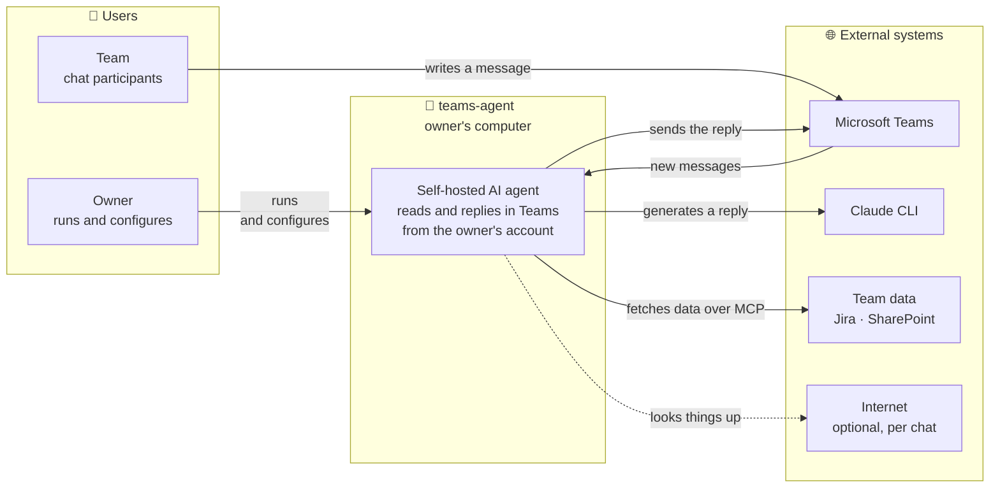
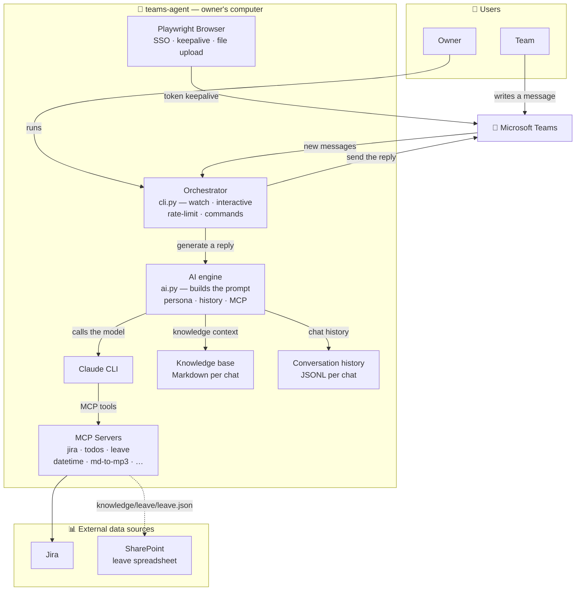
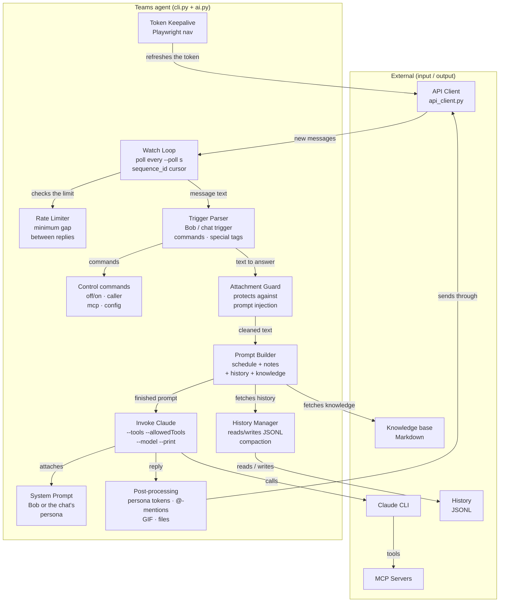

# PRD — teams-agent: a self-hosted AI agent for Microsoft Teams

**Status:** open-source project (examples use a fictional organisation, Acme)

---

## 1. Product vision and goal

`teams-agent` is a self-hosted, personal AI agent that runs directly in Microsoft
Teams from its owner's account. The default persona, **Bob**, answers messages where
someone calls him, and draws on the team's context while doing so: Jira issues,
leave, the to-do list and the owner's schedule.

Replies are generated by a locally run `claude` CLI (Claude Code). The agent, the
conversation history and the credentials live on the owner's computer — there is no
intermediate server.

**Key values:**
- A context-aware assistant available in selected Teams chats
- Access to team data over MCP (Jira, leave, to-do, date/time, …)
- Local-first: no cloud infrastructure of its own
- Security: the model has no shell and cannot write files; it sees only explicitly allowed tools

**Important:** the agent is not an official Teams bot. It uses the internal APIs of the
Teams web client with a token from the owner's browser session and sends messages from
the owner's account. This may break organisation/tenant policies and Microsoft's terms —
deploying it requires approval from IT/security (see README, "How it talks to Teams").

---

## 2. Users and personas

### 2.1 Owner

- The only administrator; runs the agent locally on their own computer
- Configures chats (`chat-config.json`, `--watch`), working modes and models
- Has control commands (Bob off/on/pause, `Bob, remember:`, `Bob caller …`)
- In the conversation history their messages carry the `OWNER_ALIAS` label (example: "Boss")
- Only the owner can teach personas (checked by the sender's MRI)

### 2.2 Chat participants

- Team members writing in watched chats
- They call the agent with the word "Bob" or the chat's trigger; in `auto` mode the agent
  may reply without being called (after waiting `hold_s`)
- The agent's replies are marked with the `[Bob]` prefix / the persona's label

### 2.3 Chat personas

- A chat can have its own persona (`chat-config.json` → `"persona"`): a different base
  prompt, label, emoji and trigger
- Template: `scripts/teams_agent/prompts/example_persona.md` (label "Assistant"; two
  tokens: one records an idea, the other teaches the persona and is honoured only from the owner)

---

## 3. Product scope

### In scope

- Automatic replies in Microsoft Teams (daemon + interactive mode)
- MCP servers: Jira (read and write), todos, leave, datetime, md-to-mp3
- Per-chat configuration: MCP groups, internet access, knowledge filter, trigger, persona, model
- Control commands in Teams messages
- Sending files as Teams attachments (`[SEND_FILE]`)
- Broadcast schedule: reports and stand-ups posted to chats on a plan (`scripts/broadcast/`)
- Private per-chat notes (`Bob, remember:`)
- Per-chat conversation history (JSONL, compaction) and memory of the people Bob talks to
- Persistent HTTP daemon mode for the MCP servers (launchd)
- The owner's schedule and reminders (`owner_schedule.py`)

### Out of scope

- Teams Bot Framework / a Microsoft Graph app
- Multiple owners / multi-tenant
- A mobile app or web UI
- Storing data in the cloud
- A translated interface: prompts are written in English and tell Bob to reply in the
  language the person wrote in

---

## 4. Functional requirements

### 4.1 Teams I/O

| ID | Requirement |
|----|-------------|
| F-01 | The agent polls Teams `chatsvc` REST every `--poll` seconds (default 5 s) |
| F-02 | New messages are identified by `sequence_id` — a restart does not cause repeat replies |
| F-03 | Replies are sent from the owner's account over the same REST, prefixed with the agent's label |
| F-04 | Its own messages are recognised by `sender_mri` and the label prefix — no echo |
| F-05 | Bearer token from a Playwright Chromium session (the owner's SSO), refreshed proactively |
| F-06 | `--interactive` mode: manual approval of replies (menu s/e/r/n/q) |
| F-07 | `--sniff-api` / `--sniff-ws` modes: inspect endpoints without sending replies |

### 4.2 Reply generation

| ID | Requirement |
|----|-------------|
| F-10 | Default model `claude-sonnet-5-5`; aliases `haiku`/`sonnet`/`opus`; per-chat model in `chat-config.json` |
| F-11 | Claude runs as a subprocess (`claude --print …`) with a timeout |
| F-12 | Base prompt chosen per chat: Bob or a persona from `ai._PERSONA_PROMPTS`; tool modules only for the MCP groups granted |
| F-13 | Conversation history injected into every call (JSONL, compaction) |
| F-14 | `--tools` / `--allowedTools` / `--permission-mode dontAsk` restrict the model — no shell, no writes |
| F-15 | Internet (`WebSearch`, `WebFetch`) enabled per chat |

### 4.3 MCP data sources

Source of truth: `_MCP_SERVERS` and `_MCP_GROUPS` in `scripts/teams_agent/ai.py`, and
`scripts/mcp_admin/ports.py`.

| Server | HTTP port | Data source |
|--------|-----------|-------------|
| `jira-read-bob` | 7126 | Jira — read (`JIRA_URL`, `ATLASSIAN_TOKEN`) |
| `jira-bob` | 7101 | Jira — write (create, comments, links) |
| `todos-bob` | 7103 | Local to-do list |
| `md-to-mp3-bob` | 7110 | Markdown → MP3 conversion |
| `leave-bob` | 7112 | Leave from a SharePoint spreadsheet (`knowledge/leave/leave.json`; `LEAVE_SHAREPOINT_URL`) |
| `datetime-bob` | 7113 | Date, time, working days |

Ports 7102–7125 and 7127–7131 stay reserved.
`mcp-config.json` is generated by `_refresh_mcp_config()` — do not edit it by hand.

### 4.4 Control commands (in Teams messages)

| Command | Effect |
|---------|--------|
| `Bob off` / `Bob on` | Turns the agent off / on |
| `Bob pause 30m` | Pauses for a set time |
| `Bob caller owner/all/auto` | Changes who triggers the agent |
| `Bob chat [name] mcp …` | MCP groups for the chat |
| `Bob, remember: <text>` | Private per-chat note |
| `Bob config [name]` | Chat configuration |
| `Bob help` | List of commands |

The Polish forms of these commands are still accepted.

### 4.5 Files and attachments

| ID | Requirement |
|----|-------------|
| F-30 | A `[SEND_FILE: <name>]` tag in a reply sends the file as a Teams attachment |
| F-31 | Upload through the Playwright browser (`attachments_upload.py`) |
| F-32 | `_neutralize_attachment_markers` strips control markers from attachment content before it is injected into the prompt |

### 4.6 Per-chat knowledge

`chat-config.json` maps a chat → a filter on files in `knowledge/`: `null` = all,
`[]` = none, a list = only the ones named.

### 4.7 Organisation configuration

Every value specific to the organisation and the owner lives in `.env`
(`scripts/org_config.py`) and in JSON files copied from `*.example.json`. A missing
value = the feature reports "not configured"; nothing is guessed.

---

## 5. Non-functional requirements

### 5.1 Performance

| Parameter | Value |
|-----------|-------|
| Reply latency (claude CLI) | a few seconds |
| Teams polling interval | 5 s (configurable) |
| Gain of HTTP daemon mode over stdio | about 36% on a typical Jira query |

### 5.2 Security

- Model without a shell or file writes; `Read` only for images in the call's own `bob_read_*` folder
- WebFetch is turned off when the call includes MCP tools with team data
- `session.json` with cookies stored with `0600` permissions; `umask 077` in `cli.main()`
- MCP HTTP daemons on `127.0.0.1` require a Bearer token (`scripts/mcp_admin/README.md`)
- "Owner only" actions are checked in code by the sender's MRI
- `.env` and configs with real values are in `.gitignore`

### 5.3 Reliability

- A `sequence_id` cursor per chat
- launchd `RunAtLoad` + `KeepAlive` for the MCP daemons
- Rate limit between replies (`--rate-limit`)
- Playwright in headed mode (Teams needs a visible browser)

### 5.4 Privacy

- Conversation history, notes and profiles of the people Bob talks to are local only (`user-data/`, in `.gitignore`)
- Data goes only to the configured integrations and to the model through the `claude` CLI

---

## 6. C4 architecture

### L1 — System Context



### L2 — Container



### L3 — Component (Teams agent)



---

## 7. Deployment model

### 7.1 stdio mode (default)

`BOB_MCP_TRANSPORT` unset. On every `claude --print` call a Python process starts per
MCP server (a few seconds of overhead). Exception: `cli.py` brings up the servers in
`ai._DAEMON_SERVERS` (Jira read) as HTTP daemons (`scripts/mcp_admin/daemon.py`).

### 7.2 Persistent HTTP daemon mode (macOS)

`BOB_MCP_TRANSPORT=http`. The servers run under launchd on `127.0.0.1:<port>` (ports:
`scripts/mcp_admin/ports.py`, range 7101–7199).

```bash
scripts/mcp_admin/install_launchd.sh    # one LaunchAgent per server
scripts/mcp_admin/status.sh             # check
export BOB_MCP_TRANSPORT=http
python3 scripts/teams_agent/cli.py
```

Logs: `~/Library/Logs/bob/mcp-*.log`. Restart after a code change:
`launchctl kickstart -k "gui/$UID/bob.mcp.<name>"`. Rollback:
`unset BOB_MCP_TRANSPORT && scripts/mcp_admin/uninstall_launchd.sh`.

### 7.3 Runtime requirements

- Python 3.11+, Playwright Chromium (headed)
- `claude` CLI on `$PATH` (Claude Code)
- `ffmpeg` on `$PATH` — only for md-to-mp3
- Dependencies: `requirements.txt` (runtime) and `requirements-dev.txt` (pytest, ruff), versions
  pinned in `constraints.txt`
- macOS for HTTP daemon mode (stdio works everywhere)
- `.env` with organisation settings and tokens (see `.env.example`)

---

## 8. Security and compliance

### 8.1 Model sandbox

The `claude` CLI always runs with `--tools`, `--allowedTools`, `--strict-mcp-config` and
`--permission-mode dontAsk`. The model has no shell, no file writes, no file reads outside
the call's own `bob_read_*` image folder, no WebFetch alongside tools with team data, and
no network beyond the allowed tools.

### 8.2 Prompt injection

Attachment content goes through `_neutralize_attachment_markers()`. Persona tokens that
act with the owner's authority (teaching) are honoured only when the sender is the
owner — whatever the model writes.

### 8.3 Authentication and tokens

- The Teams token comes from the owner's browser session (see section 1 — needs the organisation's approval)
- `session.json`, `.auth-token`, `.ic3-auth-token` (Teams Bearer tokens) with `0600`, local;
  `os.umask(0o077)` in `cli.main()`; temporary atomic-write files (`*.tmp`) in `.gitignore`
- MCP HTTP daemons: `Authorization: Bearer` from a `0600` file, MCP configs with the token in `0600` files, not in argv
- `ATLASSIAN_TOKEN` and other secrets only in `.env`

### 8.4 Openness towards the people Bob talks to

Bob writes in the first person as the owner; asked directly, he says he is an AI, and
every reply carries the `[Bob]` label. Chat participants should know that an agent may
be replying. The project is not affiliated with Microsoft; no warranty.

### 8.5 Data privacy

History, notes and profiles of the people Bob talks to are local and in `.gitignore`.
Conversation content and tool data reach the model through the `claude` CLI — include
that in the organisation's approval.

---

## 9. Known limitations and risks

| # | Limitation / risk | Mitigation |
|---|-------------------|------------|
| L-01 | Headless Chromium does not work | Playwright in headed mode |
| L-02 | A Microsoft session lasts ~7 days | `login.py`; proactive keepalive |
| L-03 | Teams' internal APIs can change without notice | `--sniff-api` / `--sniff-ws` for diagnostics |
| L-04 | Using the session token may break organisation and Microsoft policies | IT/security approval before deployment |
| L-05 | `claude` CLI is synchronous (a few seconds) | Rate limit; HTTP daemon mode |
| L-06 | HTTP daemon mode is macOS only | stdio mode; launchd → systemd on Linux |
| R-01 | Prompt injection through a message or attachment | Tool sandbox, attachment guard, MRI gates in code |
| R-02 | One MCP daemon fails | launchd KeepAlive, `healthcheck.py`, `status.sh` |

---

## 10. Backlog (not planned)

- Push (WebSocket) instead of polling
- Multiple owners on their own accounts
- Web UI for configuration
- Deployment on Linux (systemd)
- E2E tests with a Teams REST mock
