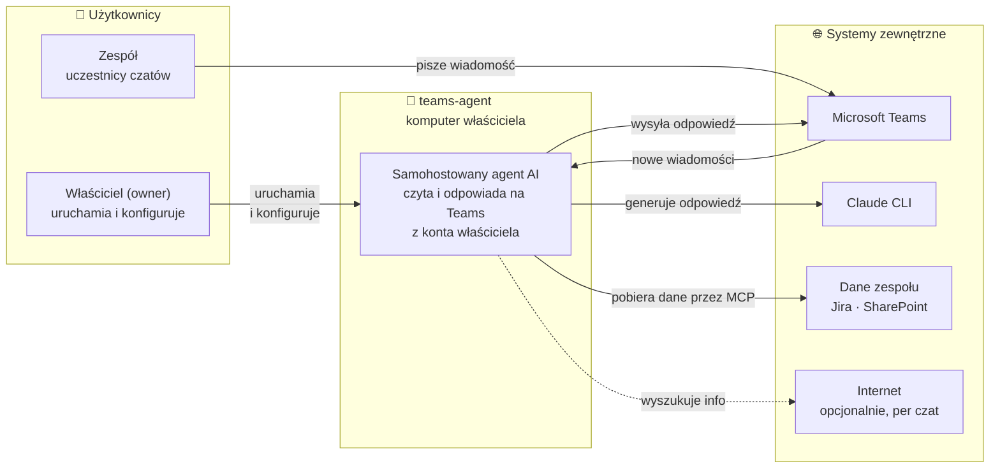
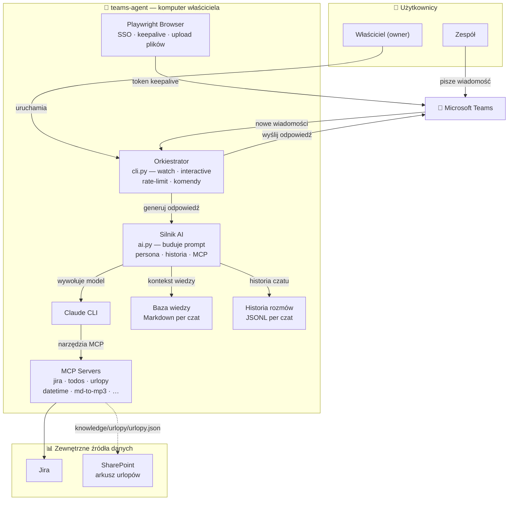
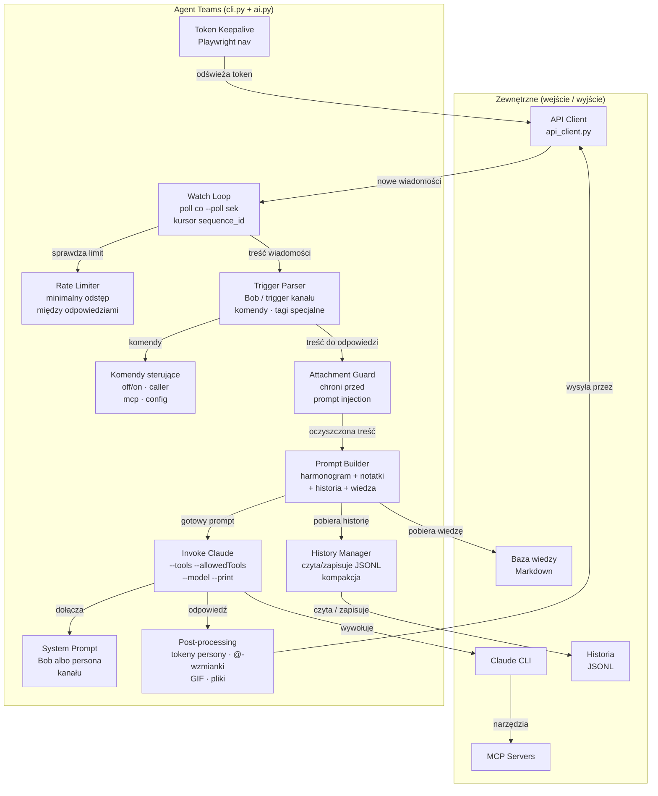

# PRD — teams-agent: samohostowany agent AI dla Microsoft Teams

**Status:** projekt open source (przykłady na fikcyjnej organizacji Acme)

---

## 1. Wizja i cel produktu

`teams-agent` to samohostowany, osobisty agent AI działający bezpośrednio w Microsoft
Teams z konta swojego właściciela. Domyślna persona, **Bob**, odpowiada na wiadomości,
w których ktoś go woła, i korzysta przy tym z kontekstu zespołu: zgłoszeń w Jirze,
urlopów, listy zadań i harmonogramu właściciela.

Odpowiedzi generuje lokalnie uruchamiany `claude` CLI (Claude Code). Agent, historia
rozmów i poświadczenia żyją na komputerze właściciela — nie ma serwera pośredniczącego.

**Kluczowe wartości:**
- Asystent kontekstowy dostępny na wybranych kanałach Teams
- Dostęp do danych zespołu przez MCP (Jira, urlopy, to-do, data/czas, …)
- Lokalność: brak własnej infrastruktury w chmurze
- Bezpieczeństwo: model nie ma shella ani zapisu plików; widzi tylko jawnie dozwolone narzędzia

**Ważne:** agent nie jest oficjalnym botem Teams. Korzysta z wewnętrznych API klienta
webowego Teams z tokenem z sesji przeglądarki właściciela i wysyła wiadomości z jego
konta. Może to naruszać zasady organizacji/tenanta i warunki Microsoftu — wdrożenie
wymaga zgody działu IT/bezpieczeństwa (zob. README, „How it talks to Teams").

---

## 2. Użytkownicy i persony

### 2.1 Właściciel (owner)

- Jedyny administrator; uruchamia agenta lokalnie na swoim komputerze
- Konfiguruje kanały (`chat-config.json`, `--watch`), tryby pracy i modele
- Ma komendy sterujące (Bob off/on/pause, `Bob, zapamiętaj:`, `Bob caller …`)
- W historii rozmów jego wiadomości mają etykietę `OWNER_ALIAS` (przykład: „Szef")
- Tylko on może uczyć persony (sprawdzane po MRI nadawcy)

### 2.2 Uczestnicy czatów

- Członkowie zespołu piszący na obserwowanych kanałach
- Wołają agenta słowem „Bob" albo triggerem kanału; w trybie `auto` agent może
  odpowiadać bez wołania (po odczekaniu `hold_s`)
- Odpowiedzi agenta są oznaczone prefiksem `[Bob]` / etykietą persony

### 2.3 Persony kanałowe

- Kanał może mieć własną personę (`chat-config.json` → `"persona"`): inny prompt
  bazowy, etykietę, emoji i trigger
- Wzorzec: `scripts/teams_agent/prompts/example_persona.md` (etykieta „Asystent";
  tokeny `[EXAMPLE-POMYSL]` i `[EXAMPLE-UCZY-SIE]`, ten drugi tylko od właściciela)

---

## 3. Zakres produktu

### In scope

- Automatyczne odpowiadanie w Microsoft Teams (daemon + tryb interactive)
- Serwery MCP: Jira (odczyt i zapis), todos, urlopy, datetime, md-to-mp3
- Per-chat konfiguracja: grupy MCP, dostęp do internetu, filtr wiedzy, trigger, persona, model
- Komendy sterujące w wiadomościach Teams
- Wysyłka plików jako załączników Teams (`[WYSLIJ_PLIK]`)
- Harmonogram broadcastów: raporty i standupy na kanały wg planu (`scripts/broadcast/`)
- Prywatne notatki per czat (`Bob, zapamiętaj:`)
- Historia rozmów per czat (JSONL, kompakcja) i pamięć o rozmówcach
- Tryb persistent HTTP daemons dla serwerów MCP (launchd)
- Harmonogram i przypomnienia właściciela (`owner_schedule.py`)

### Out of scope

- Teams Bot Framework / aplikacja Microsoft Graph
- Wielu właścicieli / multi-tenant
- Aplikacja mobilna lub web UI
- Przechowywanie danych w chmurze
- Interfejs w językach innych niż polski (prompty są dostrojone po polsku)

---

## 4. Wymagania funkcjonalne

### 4.1 Teams I/O

| ID | Wymaganie |
|----|-----------|
| F-01 | Agent odpytuje Teams `chatsvc` REST co `--poll` sekund (domyślnie 5 s) |
| F-02 | Nowe wiadomości identyfikowane przez `sequence_id` — restart nie powoduje ponownych odpowiedzi |
| F-03 | Odpowiedzi wysyłane z konta właściciela przez ten sam REST, z prefiksem etykiety agenta |
| F-04 | Własne wiadomości rozpoznawane po `sender_mri` i prefiksie etykiety — brak echa |
| F-05 | Bearer token z sesji Playwright Chromium (SSO właściciela), odświeżany proaktywnie |
| F-06 | Tryb `--interactive`: ręczne zatwierdzanie odpowiedzi (menu s/e/r/n/q) |
| F-07 | Tryby `--sniff-api` / `--sniff-ws`: podgląd endpointów bez wysyłania odpowiedzi |

### 4.2 Generowanie odpowiedzi

| ID | Wymaganie |
|----|-----------|
| F-10 | Model domyślny `claude-sonnet-5-5`; aliasy `haiku`/`sonnet`/`opus`; model per kanał w `chat-config.json` |
| F-11 | Claude uruchamiany jako subprocess (`claude --print …`) z timeoutem |
| F-12 | Prompt bazowy wybierany per kanał: Bob albo persona z `ai._PERSONA_PROMPTS`; moduły narzędzi tylko dla przyznanych grup MCP |
| F-13 | Historia rozmowy wstrzykiwana do każdego wywołania (JSONL, kompakcja) |
| F-14 | `--tools` / `--allowedTools` / `--permission-mode dontAsk` ograniczają model — brak shella i zapisu |
| F-15 | Internet (`WebSearch`, `WebFetch`) włączany per czat |

### 4.3 Źródła danych MCP

Źródło prawdy: `_MCP_SERVERS` i `_MCP_GROUPS` w `scripts/teams_agent/ai.py` oraz
`scripts/mcp_admin/ports.py`.

| Serwer | Port HTTP | Źródło danych |
|--------|-----------|---------------|
| `jira-read-bob` | 7126 | Jira — odczyt (`JIRA_URL`, `ATLASSIAN_TOKEN`) |
| `jira-bob` | 7101 | Jira — zapis (tworzenie, komentarze, linki) |
| `todos-bob` | 7103 | Lokalna lista zadań |
| `md-to-mp3-bob` | 7110 | Konwersja Markdown → MP3 |
| `urlopy-bob` | 7112 | Urlopy z arkusza SharePoint (`knowledge/urlopy/urlopy.json`) |
| `datetime-bob` | 7113 | Data, czas, dni robocze |

Porty 7102–7125 i 7127–7131 pozostają zarezerwowane.
`mcp-config.json` jest generowany przez `_refresh_mcp_config()` — nie edytować ręcznie.

### 4.4 Komendy sterujące (w wiadomościach Teams)

| Komenda | Efekt |
|---------|-------|
| `Bob off` / `Bob on` | Wyłącza / włącza agenta |
| `Bob pause 30m` | Pauza czasowa |
| `Bob caller owner/all/auto` | Zmienia, kto wyzwala agenta |
| `Bob chat [nazwa] mcp …` | Grupy MCP dla czatu |
| `Bob, zapamiętaj: <tekst>` | Prywatna notatka per czat |
| `Bob config [nazwa]` | Konfiguracja czatu |
| `Bob help` | Lista komend |

### 4.5 Pliki i załączniki

| ID | Wymaganie |
|----|-----------|
| F-30 | Tag `[WYSLIJ_PLIK: <ścieżka>]` w odpowiedzi wysyła plik jako załącznik Teams |
| F-31 | Upload przez przeglądarkę Playwright (`attachments_upload.py`) |
| F-32 | `_neutralize_attachment_markers` usuwa znaczniki sterujące z treści załączników przed wstrzyknięciem do promptu |

### 4.6 Per-chat knowledge

`chat-config.json` mapuje czat → filtr plików z `knowledge/`: `null` = wszystkie,
`[]` = żadne, lista = tylko wymienione.

### 4.7 Konfiguracja organizacji

Wszystkie wartości specyficzne dla organizacji i właściciela są w `.env`
(`scripts/org_config.py`) oraz w plikach JSON kopiowanych z `*.example.json`. Brak
wartości = funkcja zgłasza „not configured"; nic nie jest zgadywane.

---

## 5. Wymagania niefunkcjonalne

### 5.1 Wydajność

| Parametr | Wartość |
|----------|---------|
| Latencja odpowiedzi (claude CLI) | kilka sekund |
| Interwał pollingu Teams | 5 s (konfigurowalny) |
| Zysk trybu HTTP daemons vs stdio | ok. 36% na typowym zapytaniu Jiry |

### 5.2 Bezpieczeństwo

- Model bez shella i zapisu plików; `Read` tylko dla obrazów w katalogu `bob_read_*` danego wywołania
- WebFetch wyłączony, gdy w wywołaniu są narzędzia MCP z danymi zespołu
- `session.json` z cookies przechowywany z uprawnieniami `0600`; `umask 077` w `cli.main()`
- Demony HTTP MCP na `127.0.0.1` wymagają tokenu Bearer (`scripts/mcp_admin/README.md`)
- Akcje „tylko właściciel" sprawdzane w kodzie po MRI nadawcy
- `.env` i konfiguracje z prawdziwymi wartościami są w `.gitignore`

### 5.3 Niezawodność

- Kursor `sequence_id` per kanał
- launchd `RunAtLoad` + `KeepAlive` dla demonów MCP
- Rate limit między odpowiedziami (`--rate-limit`)
- Playwright w trybie headed (Teams wymaga widocznej przeglądarki)

### 5.4 Prywatność

- Historia rozmów, notatki i profile rozmówców tylko lokalnie (`user-data/`, w `.gitignore`)
- Dane trafiają wyłącznie do skonfigurowanych integracji i do modelu przez `claude` CLI

---

## 6. Architektura C4

### L1 — System Context



### L2 — Container



### L3 — Component (Agent Teams)



---

## 7. Model deployment

### 7.1 Tryb stdio (domyślny)

`BOB_MCP_TRANSPORT` nieustawiony. Przy każdym wywołaniu `claude --print` startuje proces
Pythona per serwer MCP (kilka sekund narzutu). Wyjątek: serwery z `ai._DAEMON_SERVERS`
(odczyt Jiry) `cli.py` stawia jako demony HTTP (`scripts/mcp_admin/daemon.py`).

### 7.2 Tryb persistent HTTP daemons (macOS)

`BOB_MCP_TRANSPORT=http`. Serwery działają pod launchd na `127.0.0.1:<port>` (porty:
`scripts/mcp_admin/ports.py`, zakres 7101–7199).

```bash
scripts/mcp_admin/install_launchd.sh    # LaunchAgent per serwer
scripts/mcp_admin/status.sh             # weryfikacja
export BOB_MCP_TRANSPORT=http
python3 scripts/teams_agent/cli.py
```

Logi: `~/Library/Logs/bob/mcp-*.log`. Restart po zmianie kodu:
`launchctl kickstart -k "gui/$UID/bob.mcp.<name>"`. Rollback:
`unset BOB_MCP_TRANSPORT && scripts/mcp_admin/uninstall_launchd.sh`.

### 7.3 Wymagania runtime

- Python 3.11+, Playwright Chromium (headed)
- `claude` CLI na `$PATH` (Claude Code)
- `ffmpeg` na `$PATH` — tylko dla md-to-mp3
- Zależności: `requirements.txt` (runtime) i `requirements-dev.txt` (pytest, ruff), wersje
  przypięte w `constraints.txt`
- macOS dla trybu HTTP daemons (stdio działa wszędzie)
- `.env` z ustawieniami organizacji i tokenami (zob. `.env.example`)

---

## 8. Bezpieczeństwo i compliance

### 8.1 Sandbox modelu

`claude` CLI zawsze z `--tools`, `--allowedTools`, `--strict-mcp-config` i
`--permission-mode dontAsk`. Model nie ma: shella, zapisu plików, odczytu plików poza
katalogiem `bob_read_*` z obrazami danego wywołania, WebFetch przy narzędziach z danymi
zespołu, ani sieci poza dozwolonymi narzędziami.

### 8.2 Prompt injection

Treści załączników przechodzą przez `_neutralize_attachment_markers()`. Tokeny persony
działające na uprawnieniach właściciela (nauka) są honorowane tylko, gdy nadawcą jest
właściciel — niezależnie od tego, co model napisze.

### 8.3 Uwierzytelnianie i tokeny

- Token Teams pochodzi z sesji przeglądarki właściciela (zob. sekcja 1 — wymaga zgody organizacji)
- `session.json`, `.auth-token`, `.ic3-auth-token` (tokeny Bearer Teams) z `0600`, lokalnie;
  `os.umask(0o077)` w `cli.main()`; pliki tymczasowe zapisu atomowego (`*.tmp`) w `.gitignore`
- Demony HTTP MCP: `Authorization: Bearer` z pliku `0600`, konfiguracje MCP z tokenem w plikach `0600`, nie w argv
- `ATLASSIAN_TOKEN` i inne sekrety tylko w `.env`

### 8.4 Jawność wobec rozmówców

Bob pisze w pierwszej osobie jako właściciel; na bezpośrednie pytanie mówi, że jest AI, a
każda odpowiedź ma etykietę `[Bob]`. Uczestnicy czatów powinni wiedzieć, że może
odpowiadać agent. Projekt nie jest powiązany z Microsoft; bez gwarancji.

### 8.5 Prywatność danych

Historia, notatki i profile rozmówców są lokalne i w `.gitignore`. Treść rozmów i dane
z narzędzi trafiają do modelu przez `claude` CLI — uwzględnij to w zgodzie organizacji.

---

## 9. Znane ograniczenia i ryzyka

| # | Ograniczenie / ryzyko | Mitigacja |
|---|----------------------|-----------|
| L-01 | Headless Chromium nie działa | Playwright w trybie headed |
| L-02 | Sesja Microsoft żyje ~7 dni | `login.py`; proaktywny keepalive |
| L-03 | Wewnętrzne API Teams mogą się zmienić bez zapowiedzi | `--sniff-api` / `--sniff-ws` do diagnostyki |
| L-04 | Użycie tokenu sesji może naruszać zasady organizacji i Microsoftu | Zgoda IT/bezpieczeństwa przed wdrożeniem |
| L-05 | `claude` CLI synchroniczny (kilka sekund) | Rate limit; tryb HTTP daemons |
| L-06 | Tryb HTTP daemons tylko macOS | Tryb stdio; launchd → systemd na Linuksie |
| R-01 | Prompt injection przez wiadomość lub załącznik | Sandbox narzędzi, guard załączników, bramki MRI w kodzie |
| R-02 | Awaria jednego demona MCP | launchd KeepAlive, `healthcheck.py`, `status.sh` |

---

## 10. Backlog (niezaplanowane)

- Push (WebSocket) zamiast pollingu
- Wielu właścicieli na własnych kontach
- Web UI do konfiguracji
- Deployment na Linuksie (systemd)
- Testy E2E z mockiem Teams REST
