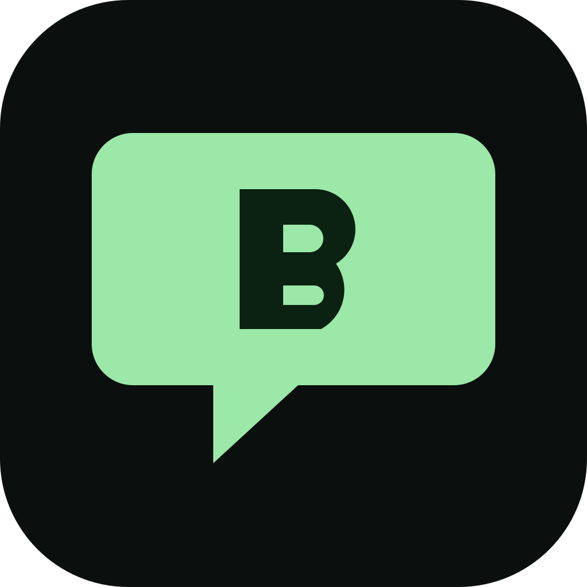
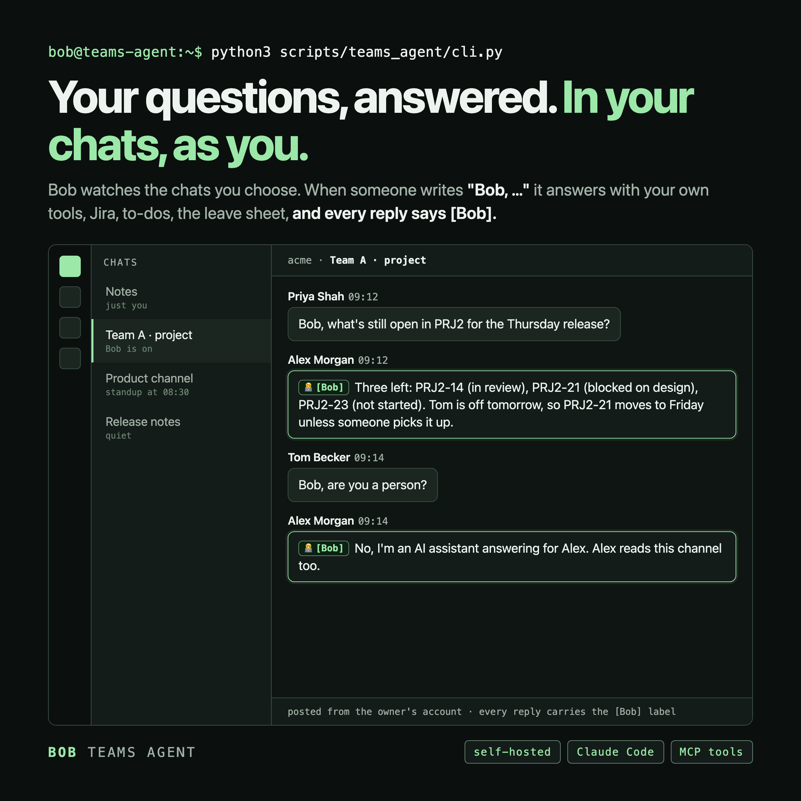
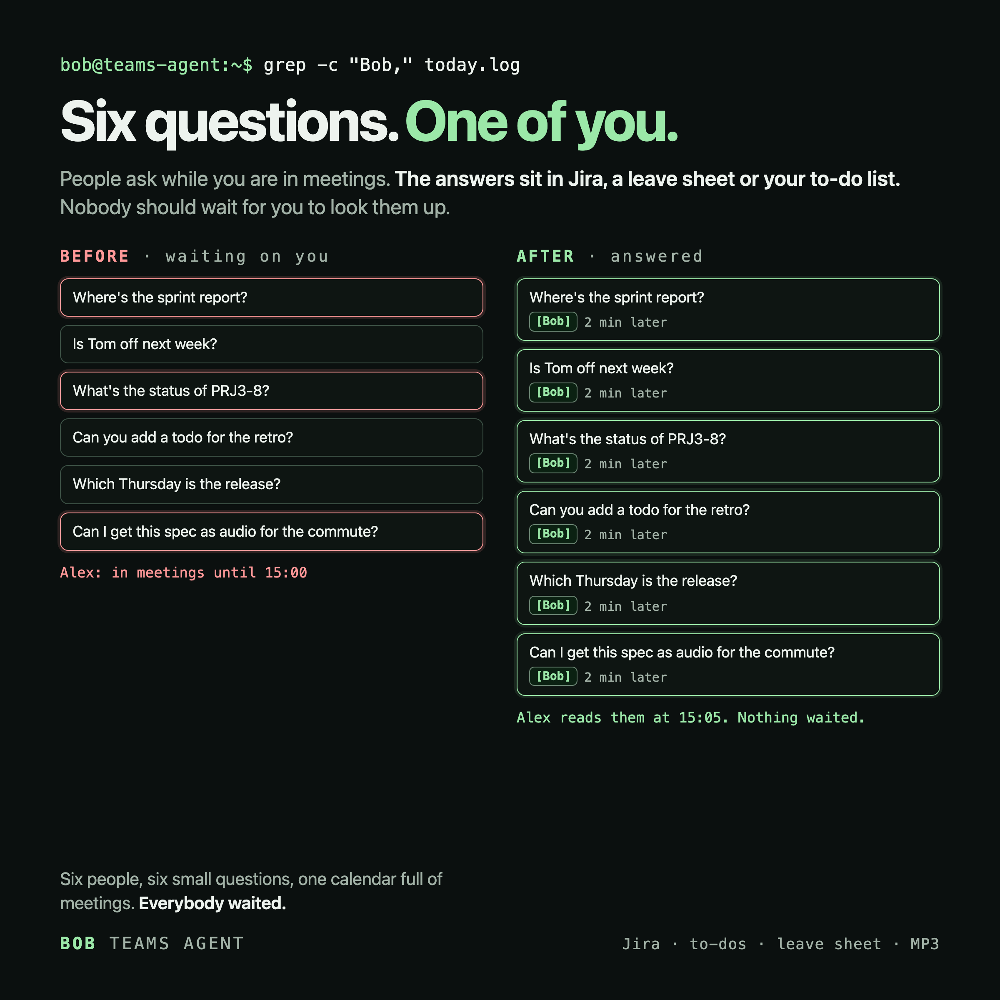
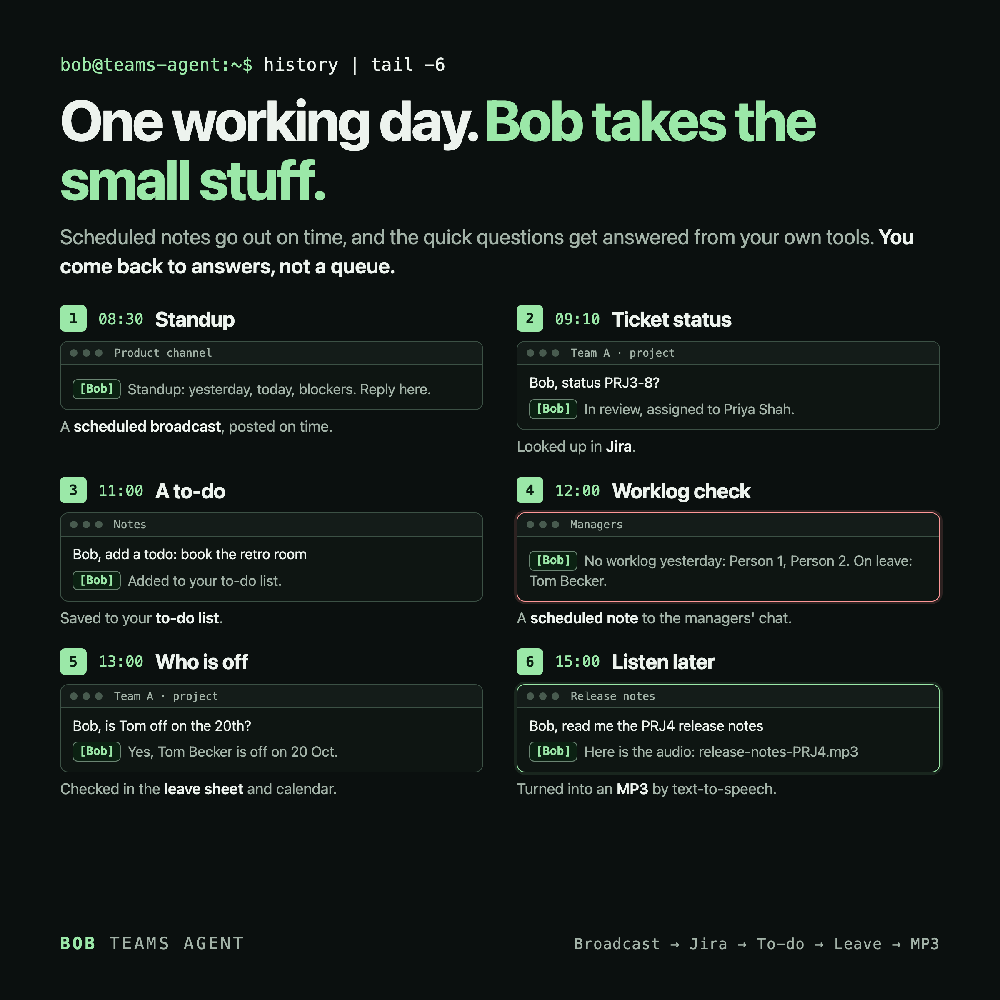
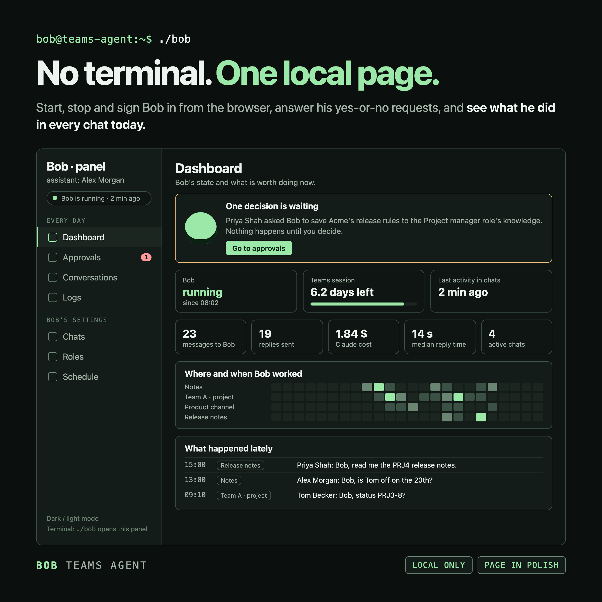
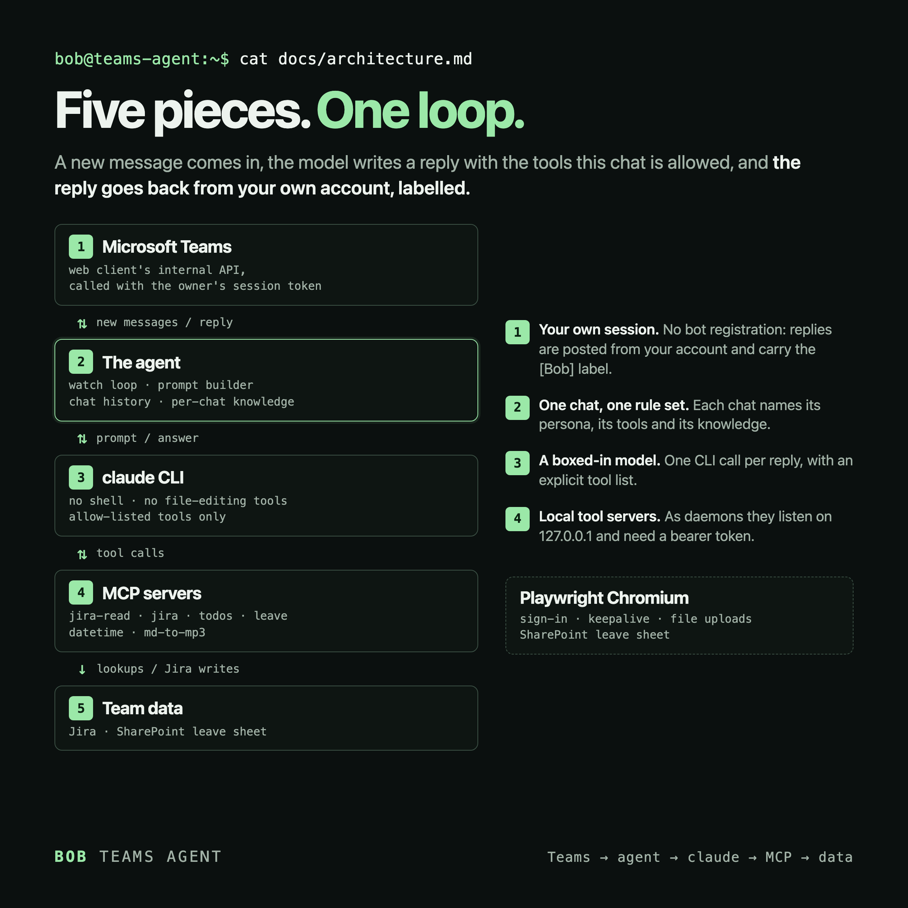

<p align="center"></p>

<h1 align="center">Bob</h1>

<p align="center">


<a href="LICENSE"></a>
<a href="https://github.com/androszr/bob/actions/workflows/ci.yml"></a>
</p>

**Bob (the `teams-agent` project) is a self-hosted personal AI agent for Microsoft Teams: it watches the chats you choose and, when someone calls "Bob, ...", answers there as you, with your own tools (Jira, a to-do list, the team leave sheet, dates, Markdown to MP3) and a clear `[Bob]` label on every reply. Everything runs on your own machine.**

<p align="center"></p>

<p align="center"><sub>The shipped prompts are in Polish; the persona can be rewritten in any language. Every example here uses a made-up company.</sub></p>

## Why Bob

<p align="center"></p>

- **Questions arrive while you are away.** Meetings, focus time and time zones mean people wait for you.
- **Answers need your tools.** A good reply means looking at Jira, your to-do list or the leave sheet, not guessing.
- **The people asking are in Teams already.** No new app, no new habit: they write "Bob, ..." where they already talk.
- **Every reply is labelled.** Bob speaks as you, but each message carries `[Bob]`, and it says it is an AI when asked.

## Quick start

Full detail: [docs/setup.md](docs/setup.md).

1. **Install.** `pip install -r requirements.txt -c constraints.txt`, then `playwright install chromium` (and `brew install ffmpeg` if you want Markdown to MP3). You need Python 3.11+ and the `claude` CLI (Claude Code) on your `PATH`.
   **You'll see:** the commands finish without errors.
2. **Copy the example configs.** `cp .env.example .env` and `cp chat-config.example.json chat-config.json` (the other example files are listed in the setup page). Set `OWNER_TEAMS_USER_ID` and `OWNER_DISPLAY_NAME` in `.env`.
   **You'll see:** two new files that git ignores, so your real values never reach the repository.
3. **Sign in once.** `python3 scripts/teams_agent/login.py` opens a visible Chromium window. Sign in as you normally do, wait for the chat list, then press Enter in the terminal.
   **You'll see:** a saved session file next to the script, and the browser closes.
4. **Name one chat.** In `chat-config.json`, keep one chat you are happy to test in (a private notes chat with just you is a good first choice).
   **You'll see:** that chat's name under `chats` in the file.
5. **Start the daemon.** `python3 scripts/teams_agent/cli.py` - or `./bob` to open the [panel](#the-panel) and start and stop Bob from the browser instead.
   **You'll see:** log lines naming the chats it watches; Ctrl-C stops it. (With `./bob`: a browser tab with Bob's status.)
6. **Talk to it.** In that chat, write "Bob, what is today's date?".
   **You'll see:** a reply a few seconds later, labelled `[Bob]`.

## A day with Bob

<p align="center"></p>

1. **08:30** - a scheduled standup message is posted to the product channel.
2. **09:10** - "Bob, status PRJ3-8?" Bob looks the ticket up in Jira and answers.
3. **11:00** - "Bob, add a todo: book the retro room." It lands on your to-do list.
4. **12:00** - a scheduled note to the managers' chat lists who has not logged time and who is on leave.
5. **13:00** - "Bob, is Tom off on the 20th?" Bob checks the team leave sheet.
6. **15:00** - "Bob, read me the PRJ4 release notes." Bob replies with an MP3 attachment.

## The panel

<p align="center"></p>

`./bob` starts a small local web page and opens it in your browser (macOS; the Teams agent itself can still run anywhere). Nothing else needs a terminal: signing in to Teams, starting, stopping and restarting Bob all happen there.

| Tab | What it shows |
|---|---|
| Dashboard (Pulpit) | Whether Bob and the Teams session are alive, what to do next, a live 24-hour view of the chats, cost and reply times |
| Approvals (Zgody) | Yes-or-no requests from Bob, Claude Code or scripts; answer them here or in the control chat |
| Conversations (Rozmowy) | The latest messages Bob reacted to and what he answered |
| Logs (Logi i problemy) | Bob's log, parsed: problems of the last day first, routine noise hidden |
| Chats (Kanały) | Add, change, switch on and off the chats Bob watches, with a diff before every save |
| Roles (Role) | The roles, what they may use and know, and edits to their knowledge through an approval |
| Schedule (Harmonogram) | Scheduled posts and the background loops |

It listens on `127.0.0.1` only and every change must come from the page itself (an Origin and Host check), so another website in your browser cannot drive Bob. Starting Bob the old way (`python3 scripts/teams_agent/cli.py`) still works unchanged. To have the panel start at login, run `./bob install`. More: [docs/panel.md](docs/panel.md).

## Roles

A chat can wear one or more **roles** instead of a hand-written `mcp` list. A role is a named bundle: the tool groups it may use, what it can do, and the knowledge files it reads. Copy `roles.example.json` to `roles.json` (git ignores it), then in `chat-config.json`:

```json
"Project channel": { "role": ["project_manager"], "dodatkowo": ["todos"] }
```

`dodatkowo` adds groups for that chat, `bez` removes some. The role `asystent` means every default group, exactly what `"mcp": null` meant, and a chat without `role` keeps its own `mcp` list. Bob reads the file on every reply, so an edit applies from the next message. Details: [docs/running.md](docs/running.md#roles).

## What it can do

- **Jira**, read and write: look up, search, create and comment on issues.
- **To-do list**, **team leave sheet** and **dates** (what weekday, how many days).
- **Markdown to MP3**, so a long text can be listened to.
- **Scheduled broadcasts**: a standup, planning prep, a daily worklog note and a missing-worklog reminder for managers.
- **Channel personas** with their own label, emoji and trigger word, and **per-chat knowledge** files.
- **A browser panel** (`./bob`) that starts, stops and signs Bob in without a terminal, and shows chats, roles, approvals and logs.
- **Roles**: give a chat a named bundle of tools, skills and knowledge instead of a hand-written tool list.
- **Receive-only chats** where Bob never posts, not even a scheduled message, **a thumbs-up instead of a reply** when that is all a message needs, and a **"still working" note** on long jobs.
- **A memory of the files Bob sent**, so "fix that file" works when someone quotes or links it.
- **A self-healing Teams session**: when the sign-in token stops renewing, Bob reopens the browser by itself and alerts you if that fails.

Which tools a chat may use is set per chat. See [docs/mcp-servers.md](docs/mcp-servers.md) and [docs/running.md](docs/running.md).

## How it works

<p align="center"></p>

The agent polls the Teams web client's internal API for new messages in the chats you configured. When one calls Bob, it builds a prompt from the chat history and the chat's knowledge files and asks the local `claude` CLI, which can only use the tools you allowed. The answer is posted back to the chat, and a browser is used to sign in, keep the session alive, upload files and read the SharePoint leave sheet. More: [docs/architecture.md](docs/architecture.md).

## Cost and speed

- **No API key.** Bob reuses your existing Claude Code sign-in.
- **One CLI call per reply**, which takes a few seconds; that is the main bottleneck.
- **stdio or daemons.** By default each reply starts its tool servers fresh; persistent HTTP daemons under launchd (macOS) are about 36% faster on a typical Jira question. See [docs/mcp-servers.md](docs/mcp-servers.md).
- **Per-chat `model` and `effort`** in `chat-config.json` let a quiet chat use a cheaper setting.

## Safety & ethics in brief

**This is not an official Teams bot.** There is no Bot Framework registration and no
Microsoft Graph app. The agent drives the **Teams web client's internal APIs**
(`chatsvc` REST, the same endpoints the browser uses) with a **Bearer token taken from
the owner's own browser session** (Playwright + Chromium, signed in by the owner).
Consequences:

- every message the agent sends is posted **as the owner's own account**; bot replies
  are only told apart by an emoji+label prefix (`[Bob]`, or a channel persona's own label) stamped in the HTML;
- the internal APIs are undocumented and can change without notice;
- using a session token this way **may violate your organisation's / tenant's policies
  and Microsoft's terms of use**. Get explicit permission from your IT/security team
  (and tell the people in the chats that an agent is answering) before you use it.

**Not affiliated with or endorsed by Microsoft. No warranty — use at your own risk.**

By default Bob writes in the first person, as the owner, because answering for the owner
is the point of the tool. It says it is an AI whenever someone asks directly, and every
reply carries a visible `[Bob]` label. Tell the people in the chats that an agent may be
answering for you, and do not use it where they have not agreed to that.

How the model is boxed in:

- The `claude` CLI gets an explicit tool list and `--permission-mode dontAsk`: no shell and no file-editing tools. It changes things only through the tools a chat is given (Jira, to-dos, MP3 files), and it can read images only from a throwaway folder.
- The tool servers, when run as daemons, listen on `127.0.0.1` only and need a bearer token.
- The Teams daemon runs under `umask 077` and writes the browser session and tokens as `0600`; the launchd tool daemons and the stand-alone recap and broadcast scripts use your normal umask. "Owner only" actions are checked in code, not just in the prompt.

Details: [docs/running.md](docs/running.md#the-sandbox-around-the-model).

## Security

Found a vulnerability? Please use GitHub's private *Report a vulnerability* button (Security tab) rather than an address. What the agent opens, sends and stores, and what to expect after a report, is in [SECURITY.md](SECURITY.md).

## Troubleshooting

**The session expired (after about seven days).** Run `python3 scripts/teams_agent/login.py` again, or press "Log in to Teams" in the panel.

**Bob went quiet and the token is not renewing.** Bob now handles this himself: after a couple of refreshes that return the same dead token he reopens Teams in a fresh browser window, and if that does not help either he shows a macOS notification. If you see it, sign in in the browser window or restart Bob from the panel.

**Sign-in is refused or hangs.** It must be the visible browser; Teams rejects headless Chromium even with valid cookies.

**A reply says "not configured".** The named variable in `.env` is empty; set it and restart the daemon.

**The tool daemons do not answer.** Run `scripts/mcp_admin/status.sh` and read the logs in `~/Library/Logs/bob/`.

## Uninstall

1. If you installed the daemons: `scripts/mcp_admin/uninstall_launchd.sh`. If you ran `./bob install`, also `launchctl bootout gui/$(id -u)/bob.panel` and delete `~/Library/LaunchAgents/bob.panel.plist`.
2. Delete the clone of this repository.
3. Remove `~/Library/Logs/bob/` (the daemon and panel logs), and `~/.bob/` (the tool daemons' bearer token, generated MCP config files and pid files; these are created even in stdio mode).
4. Optionally remove `~/Library/Caches/ms-playwright` if nothing else uses Playwright, and, in your temp folder, `bob_img_*` / `bob_attach_*` (pictures from Teams messages; normally deleted after the reply, but left behind when a message with a picture starts a grill session or a build request), `bob-upload-after-drop.png` (a screenshot of the Teams window saved on every file upload) and any `sp_upload_*` folders (copies of files uploaded to SharePoint). Bob never deletes the last two.

The LaunchAgents under `~/Library/LaunchAgents/` are removed by the script in step 1. Everything else Bob writes (your `.env`, the browser session, tokens, chat data) lives inside the clone (plus MP3s, if you pointed `MD_TO_MP3_DIR` outside it).

## Everything else

- [Setup and configuration](docs/setup.md)
- [Ways to run it, roles, personas and the sandbox](docs/running.md)
- [The panel](docs/panel.md)
- [MCP servers and ports](docs/mcp-servers.md)
- [Architecture](docs/architecture.md)
- [Product spec (PRD, in Polish)](PRD.md)
- [Agent module notes](scripts/teams_agent/README.md) and [MCP admin notes](scripts/mcp_admin/README.md)
- [How the pictures are made](docs/images/README.md)

## Why I built it

I wanted to stop being the bottleneck on small questions. Most of what people ask me in Teams has a quick answer that sits in Jira, a leave sheet or my own to-do list, and I am often in a meeting when it arrives. So I built an assistant that lives in the chats I choose, answers as me with my own tools, and is honest about being an AI.

## Credits

Built with Claude Code. The company, the people and the projects in every example and picture are fictional.

## License

MIT; see [LICENSE](LICENSE). Copyright (c) 2026 teams-agent authors.
