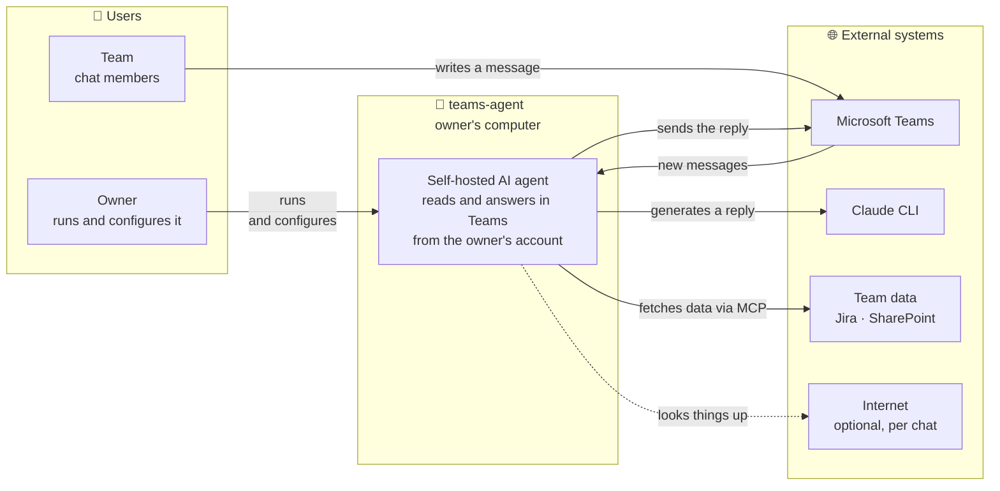
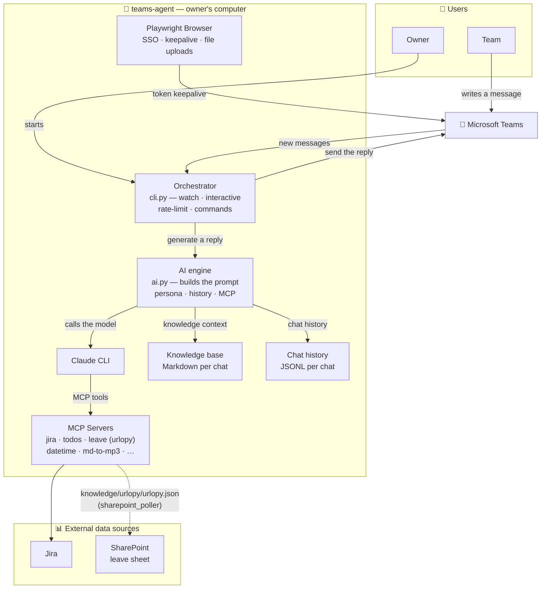

[Back to the README](../README.md)

# Architecture

## Stack

- Python 3.11+
- Playwright (Chromium, headed - Teams rejects headless even with valid cookies) - SSO,
  token refresh, file upload
- Teams `chatsvc` REST - reading and sending messages
- `claude` CLI on `PATH` (Claude Code), default model `claude-sonnet-5-5`
- MCP (`mcp>=1.0`) - tools for the model

## C4 architecture

The full architecture (L1 + L2 + L3): [`PRD.md` - section 6](../PRD.md#6-architektura-c4).

### L1 - System Context



### L2 - Container



## Layout

```
teams-agent/
├── scripts/
│   ├── org_config.py      — organisation/owner settings from .env
│   ├── teams_agent/       — the Teams agent
│   │   ├── login.py       — one-time SSO + saves session.json
│   │   ├── session.py     — session.json freshness (TTL ~7 days)
│   │   ├── api_client.py  — Teams chatsvc REST: get/send/reply, persona labels
│   │   ├── scraper.py     — Playwright DOM (navigation + keepalive)
│   │   ├── ai.py          — prompt, personas, MCP groups, claude CLI call
│   │   ├── cli.py         — orchestrator: watch / interactive / sniff
│   │   ├── prompts/       — Bob's prompt, tool modules, template persona
│   │   └── eval/          — regression suite for replies (run_eval.py)
│   ├── jira/              — Jira MCP servers (read and write) + REST client
│   ├── mcp_admin/         — HTTP MCP daemons (launchd), ports, healthcheck
│   ├── broadcast/         — schedule of reports and standups to channels
│   └── …                  — todos, urlopy, datetime_bob, md_to_mp3, …
├── knowledge/             — knowledge base (Markdown) injected per chat
├── templates/             — issue and meeting-note templates
├── tests/                 — pytest (mock Playwright, REST and the claude CLI)
├── docs/                  — these pages and the README pictures
├── tools/                 — readme_images.py: redraws and checks the pictures
├── .env.example · chat-config.example.json · config/jira-fields.example.json
└── pyproject.toml         — ruff + pytest
```

The agent module in detail (module table): [`scripts/teams_agent/README.md`](../scripts/teams_agent/README.md).
