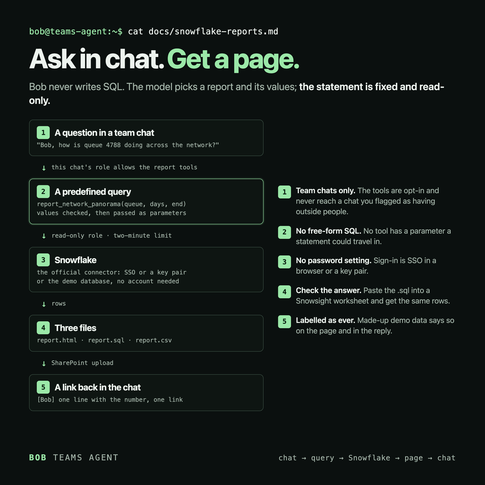
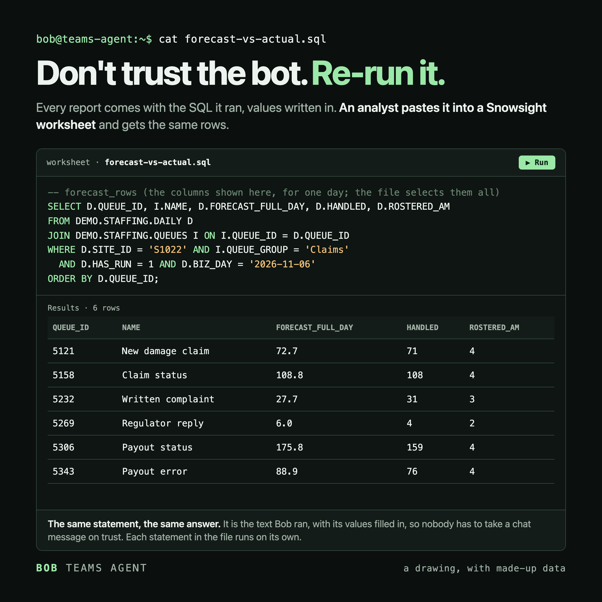

[Back to the README](../README.md)

# Snowflake reports

Someone asks in a team chat, Bob runs a predefined read-only query, and the answer comes back as one line and a link to an interactive page. The code is in `scripts/snowflake_bob/`.



## Try it without an account

Nothing to install beyond Python 3.11+. The made-up data set (100 sites, 43 queues, 60 days) is generated from a fixed seed. It follows one example throughout: an engine suggests how many extra agents each contact-centre queue needs at each site, and a team lead accepts or changes that. The idea fits any engine whose suggestions people review.

```bash
python3 scripts/snowflake_bob/build_samples.py
open docs/reports/index.html
```

To let Bob answer from the demo data in a chat, give that chat the `snowflake` group (below). Until Snowflake is configured, every report says "Made-up demo data" on the page, and the tool's answer tells the model to say so in its reply.

## The three reports

| Report | Tool | What it answers | Sample |
|---|---|---|---|
| Morning Pulse | `report_morning_pulse` | How did team leads treat the day's suggested staffing plans? Whole network and key queues, by group and down to the queue. | [page](reports/morning-pulse.html), [SQL](reports/morning-pulse.sql) |
| Network Panorama | `report_network_panorama` | How is one queue doing across all sites, day by day? | [page](reports/network-panorama.html), [SQL](reports/network-panorama.sql), [CSV](reports/network-panorama.csv) |
| Forecast vs Actual | `report_forecast_vs_actual` | Does the forecast match the contacts handled, for one queue group at one site? By weekday, by day and by queue. | [page](reports/forecast-vs-actual.html), [SQL](reports/forecast-vs-actual.sql) |

Each page is one self-contained HTML file: the data is JSON inside it and the charts are drawn by inline JavaScript. It loads nothing from outside and works on a desktop or a phone. GitHub shows these files as source code; the [README](../README.md#reports-from-snowflake) links to live copies.

The rule names, the report names and the contact-centre setting are examples. The rules in the demo are invented.

## Connect it to Snowflake

1. Install the connector: `pip install -r requirements-snowflake.txt`.
2. Create a role that can only read the report tables.
3. Set these in `.env`:

   ```bash
   SNOWFLAKE_ACCOUNT=your-account
   SNOWFLAKE_USER=your-user
   SNOWFLAKE_ROLE=REPORT_READER
   SNOWFLAKE_WAREHOUSE=your-warehouse
   SNOWFLAKE_SCHEMA=DEMO.STAFFING
   ```

Sign-in is SSO in a browser by default (`SNOWFLAKE_AUTHENTICATOR=externalbrowser`). For a process nobody is watching, set `SNOWFLAKE_PRIVATE_KEY_FILE` to use a key pair instead. There is no password setting on purpose, so a key file must be unencrypted: `chmod 600` it. SSO keeps its token in the system keychain, so it asks once rather than on every report; your account may need `ALLOW_ID_TOKEN` turned on for that.

A statement stops after two minutes, a result over 50,000 rows stops the report instead of drawing a partial page, and statements carry the query tag `bob-report`, so you can find them in the query history.

### Your own tables

The queries in `scripts/snowflake_bob/queries.py` read five tables: `SITES`, `QUEUES`, `DAILY`, `PLANS` and `PLAN_LINES`. Their columns are listed in `TABLES` in `demo_data.py`. The easiest way to use your own data is to create views with those names and columns in one schema. Day columns (`BIZ_DAY`) must be `DATE`, and `HAS_RUN` and `KEY_QUEUE` must be the numbers 0 or 1, not `BOOLEAN`. `LAT` and `LON` are decimal degrees; the site card draws a UK map, and leaves it out for a site with no coordinates or one outside the UK.

### Load the demo data into a trial account

This lets you check the real connector and a real Snowsight worksheet with nothing private in them. A new trial account usually has no SSO, so use a key pair there: generate one, then run `ALTER USER your_user SET RSA_PUBLIC_KEY='...'` and set `SNOWFLAKE_PRIVATE_KEY_FILE`.

```bash
python3 scripts/snowflake_bob/demo_data.py --export /tmp/bob-demo
```

Run `create-tables.sql` in a worksheet, then load each CSV into its table. The file format needs `SKIP_HEADER = 1` and `FIELD_OPTIONALLY_ENCLOSED_BY = '"'`, so quoted text loads correctly.

## Re-run a report in Snowsight



Every report comes with a `.sql` file: each statement it ran, with its values written in. Paste it into a Snowsight worksheet and run a statement to get the rows behind the page. On the demo source the file names `DEMO.STAFFING` too, so it works against the trial data above. The `.csv` file is the report's main result.

## Where the files go

Reports are written to `user-data/reports/` (git ignores it), readable only by you, and they stay there until you delete them. A real report holds real numbers, so treat that folder like your data. `BOB_REPORT_DIR` moves it.

With `SHAREPOINT_UPLOAD_FOLDER_URL` set, the three files are also uploaded and the chat gets links. There the folder's own access rules apply, not the owner-only ones. The page's link ends in `?web=1`, because the plain address downloads the file while `?web=1` opens it in the SharePoint viewer. If an upload fails, or no folder is set, the report stays on your machine and the answer says so.

`BOB_REPORT_ORG` and `BOB_REPORT_TEAM` set the names in a real report's page header, and `BOB_REPORT_CURRENCY` the sign in front of plan costs (none by default). Named people (team lead, planner, director) are left off a real report's site card unless you set `BOB_REPORT_CONTACTS=1`; the demo pages show made-up ones. In the CSV, a text cell that starts like a spreadsheet formula gets a leading `'`, so it opens as text.

## Who can use it

`snowflake` is an opt-in group, so a chat never gets it by default. Give it through a role or a chat's own list:

```json
"Data team": { "role": ["data_analyst"] }
```

The group is always team-only, so a chat marked `"kanal_fr": true` never gets it, whatever its roles or `roles.json` say, and a scheduled job that uses it on such a chat refuses to run. That flag is the check: you set it per chat, nothing looks at who is really in the chat, and a job's channel missing from `chat-config.json` has no flag to read. Everyone in a chat with the group runs reports under your Snowflake sign-in.

The model has no tool that takes SQL: it picks a report and passes values, and each value must match a strict shape before it is passed as a parameter to a fixed statement.

## Scheduled reports

`scripts/broadcast/jobs.example.json` has a `morning-pulse` job, switched off, and `broadcast-schedule.example.json` sets it for 07:30. Copy both, set the channel and enable the job.

## Support tickets

Give a role both `snowflake` and `jira`. When someone gives a ticket key and asks about a forecast, Bob reads the ticket, runs Forecast vs Actual and writes a proposed reply as text for the team to check. The prompt tells it not to comment on the ticket or change its status itself. `jira` here is read-only; only `jira_write` can post.

## The browser route

Without a service account, the same statements can be run in a Snowsight session in a browser, signed in as a person, with the result exported as CSV. This repository has **no driver for that**. Automating a web session this way may break your organisation's policies, for the same reasons given in the README about the Teams session. Ask first, and prefer the connector with a read-only role.

## What the tests cannot see

The suite runs every statement on the demo database and the connector path against a stand-in module. It has not run against a live Snowflake account. To try one, load the demo data as above and ask for a report.

Not affiliated with or endorsed by Snowflake. Snowflake and Snowsight are trademarks of their owner.
